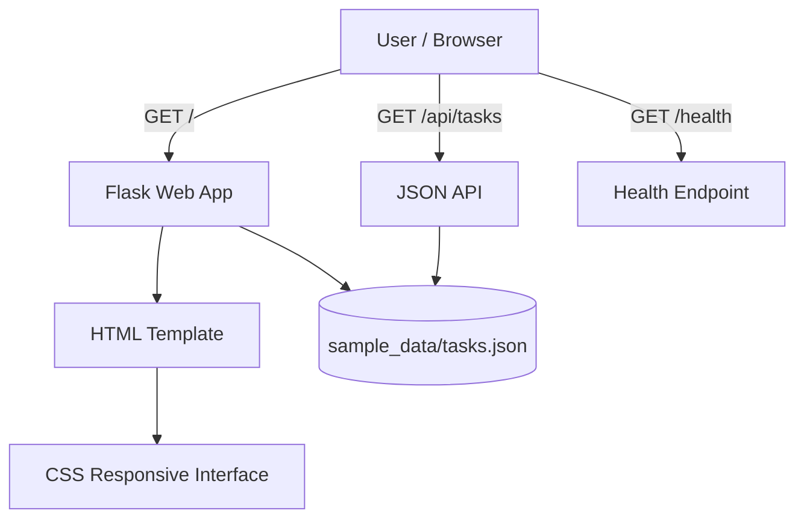

# Technical Design Document — Beyond the Screen

## 1. Purpose
A minimal proof-of-concept for presenting plain-language, step-by-step instructions for common digital tasks. It demonstrates a possible interface, not an integration with any official service.

## 2. Architecture

## 3. Components
- **Presentation:** `templates/index.html` renders the task list and task instructions.
- **Styling:** `static/style.css` provides responsive layout, visible focus states, and readable typography.
- **Application:** `app.py` serves the home page and read-only JSON endpoints.
- **Data:** `sample_data/tasks.json` contains fictional, static examples.
- **Tests:** `tests/test_app.py` checks the main page, API response, and health endpoint.

## 4. Routes
| Method | Route | Purpose |
|---|---|---|
| GET | `/` | Render task cards |
| GET | `/api/tasks` | Return task data as JSON |
| GET | `/health` | Basic health check |

## 5. Data model
Each task has `id`, `title`, `audience`, `summary`, and `steps` fields. The examples are generic and are not official government instructions.

## 6. Security and privacy
The prototype does not accept form submissions or store user information. Before deployment, disable debug mode, use a production WSGI server, add appropriate security headers, validate any future input, and conduct privacy and accessibility reviews.

## 7. Limitations
- No official service integration or real-time validation.
- No authentication, database, or analytics.
- Sample instructions must be checked with users and qualified service providers.
- Regional-language support is a planned feature, not yet implemented.

## 8. Evaluation plan
Conduct voluntary usability sessions with informed consent. Measure whether users can find a task, understand the steps, and complete a mock task. Do not collect unnecessary personal data. Report findings honestly and avoid claiming impact before testing.
